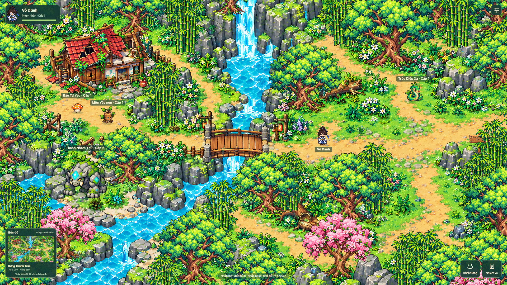
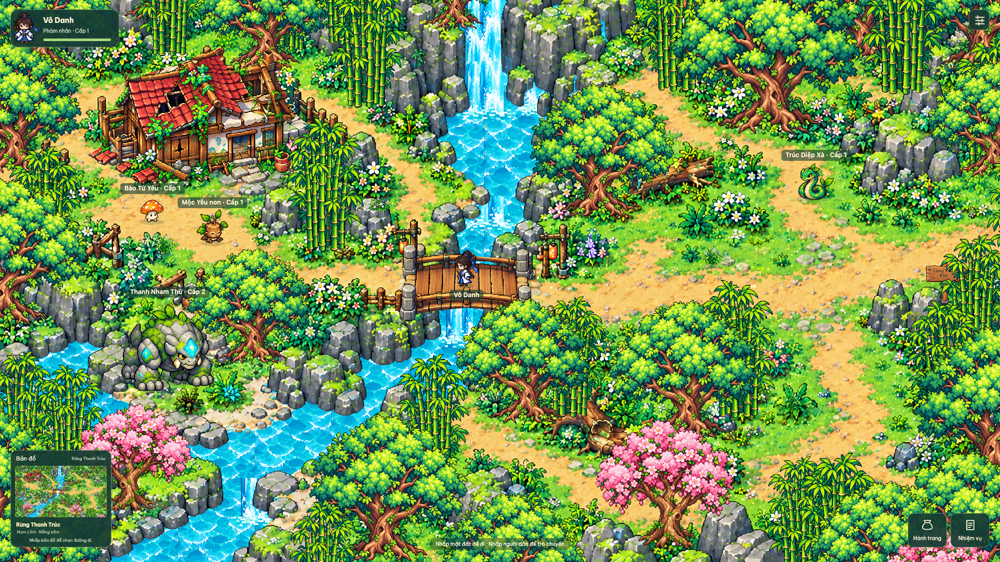

# Rừng Thanh Trúc E — asset, animation và chiêu quái

Thực hiện 16–17/10/2026 theo yêu cầu làm lại của người dùng. Ảnh chuẩn: `assets/references/forest-selected-2026-10-16.png`. Giữ nhà hoang trên trái, thác/suối giữa, cầu gỗ, bãi thú đá dưới trái, đường vòng phía đông. Không mở lại lựa chọn mockup. CONTEXT.md được đọc và giữ nguyên theo quy ước project.

## Vì sao bản trước không đạt

Renderer vẫn tải `landscape-v2` chứa cây và nước tĩnh, dù chat trước đã tạo `ground-v3`, ba sprite cây và metadata. Phần wiring chưa được hoàn thành. Hai quái mới có ảnh riêng nhưng sao cấu trúc bốn chiêu cũ, chủ yếu đổi tên/tham số. Test cũ chứng minh đường đi và một vùng hiệu ứng đổi pixel, chưa chứng minh cây/quái có animation độc lập. Kết luận hoàn tất hình ảnh trước đó quá sớm; báo cáo này thay thế kết luận đó.

## Đã nối vào runtime

- `engine/forest-environment.ts`: mặt nước dùng atlas animation riêng, mask bờ đo offline; thác có texture rơi và bọt ở chân. Cây/trúc/hoa thân gỗ là sprite alpha độc lập; gió biến dạng dần theo chiều cao, gốc giữ cố định. Collider lấy cùng vị trí gốc, lớp che sắp theo chân. Nền còn địa hình/đá/hoa thấp, không có quái hoặc tán cây/nước động nhúng sẵn.
- `engine/renderer.ts`: tải các asset thật, vẽ nền trực tiếp theo camera/DPR, nối sprite idle cho bốn loài (4 frame/loài), cập nhật vùng bấm theo bounding box mới và minimap theo các lớp mới. Giảm chuyển động cố định frame và hiệu ứng môi trường.
- Combat tiếp tục dùng sprite side-view chuyên dụng hiện hữu, chọn pose đi/nghỉ/báo/nện/cắn theo trạng thái thật. Atlas idle mới chỉ dành cho khám phá, không thay sprite ngang bằng hình top-down.
- `combat/geometry.ts`: ground hazard dùng chung hình học/timing cho renderer và collision. Chiêu mới có target lock, báo đủ vùng, một hit/cast và iframe. Dash warning dừng ở biên arena thật, active chỉ theo thân đang lao.

| Loài | Khác biệt gameplay |
|---|---|
| Mộc Yêu non cấp 1 | Hạt/rễ có artwork riêng; Địa Căn làm chậm chân khi trúng. Giữ quét cành và lao thân. |
| Bào Tử Yêu cấp 1 | Đạn bào tử, quạt bào tử, vùng bào tử và đập mũ; artwork bào tử riêng thay đạn oval/cột trơn. |
| Trúc Diệp Xà cấp 1 | Ba lá quạt đồng thời; quét đuôi thấp; cắn gần làm chậm; lao thấp để người chơi nhảy qua. |
| Thanh Nham Thú cấp 2 | Sóng đá thực sự lan trên mặt đất; ba điểm đá trồi theo chuỗi đã khóa; nện gần và húc nặng hồi lâu. |

Thông số là cân bằng triển khai ban đầu. Giữ ID quái, save túi/lượt, công thức stats, AI trọng số, luật hồi 5 phút/lượt chạy ngầm và HUD combat B. Ngoài map quái có idle animation tại lãnh địa; chưa thêm roaming/chase. Chưa mở rộng XP/loot hoặc đủ nội dung 15 cấp.

## Asset và nguồn

Mới tạo bằng **built-in ImageGen**, không CLI/API fallback:

- [16 frame quái](../../assets/production/forest/monsters-idle-v4.png) và [source rectangles](../../assets/production/forest/monsters-idle-v4.json).
- [8 hình hiệu ứng chiêu](../../assets/production/forest/skill-effects-v4.png) và [source rectangles](../../assets/production/forest/skill-effects-v4.json).
- [8 texture nước/thác](../../assets/production/forest/water-flow-v4.png) và [metadata](../../assets/production/forest/water-flow-v4.json).
- Prompt chính xác: [quái và chiêu](../../assets/prompts/forest-rebuild-2026-10-16.json), [nước](../../assets/prompts/forest-water-v4.json).

Tái sử dụng các asset đã tạo nhưng chưa nối ở chat trước: `ground-v3.png`, `tree-v3.png`, `bamboo-v3.png`, `blossom-v3.png`, `vegetation-v3.json`, `water-v3.json`. Chat trước không lưu prompt chính xác cho bộ v3; manifest ghi rõ nguồn chat và thiếu sót này, không dựng lại prompt giả. Nhà/cầu và sprite combat dùng bản production hiện hữu.

Tất cả asset dùng mới có file trong project và bản phân phối tương ứng, hash/version/QA trong `assets/manifest.json`; đăng ký qua `tools/register-forest-rebuild.mjs`. Đã xem trực tiếp ảnh runtime và warning/active của 16 chiêu, đo alpha/rectangles. Hàng thú đá từng chạm ranh giới ô đã được đo lại theo connected components, không chia atlas đều để cắt mất chân. `check-game-quality.mjs` kiểm tra thêm atlas idle/VFX.

## Kiểm thử và bằng chứng

- Unit: **74/74 đạt**. Bao gồm toàn bộ skill catalog, wave travel/jump, ba điểm eruption/timing, slow ảnh hưởng quãng đường/hết hạn/đỡ/iframe, path/collider, bridge, bag/save/lượt.
- Vòng full đầu: **45/46 browser đạt**; ca animation mới thất bại do phép so hai ảnh truyền mảng pixel lớn qua CDP có thể lấy lại cùng pose trong vòng lặp. Đã chuyển phép đo vào browser, lấy chín mẫu trong cả chu kỳ. Không đổi renderer hoặc hạ ngưỡng để chữa test.
- Ca animation sửa: **3/3 lần đạt**; từng vùng cây/trúc/thác và bốn loài thay đổi trên 1% mẫu RGB, thực đo khoảng 35–67% tùy vùng. Khi giảm chuyển động, cả bảy vùng có 0 thay đổi qua ba mẫu. [JSON](forest-rebuild-animation-results.json).
- Vòng `npm --prefix game run verify` cuối: **74 unit + 46 browser đạt**, không skip/flaky; TypeScript/Vite build đạt. [Log đầy đủ](forest-rebuild-verify-final.log), [JSON browser](forest-rebuild-final-browser.json). Audit asset cuối sau bổ sung metadata nước: **77 asset, 0 chờ review**, `node tools/check-game-quality.mjs` đạt.
- Performance: Đo riêng trên Chrome headless production sau khi suite kết thúc, bật hiệu ứng, mỗi cấu hình warmup 4 giây + lấy mẫu 4 giây: 1280×720 DPR1, 1920×1080 DPR2, 2560×1440 DPR1, 720×900 DPR2 đều khoảng **60 FPS**, p95 **16,7–16,8 ms**, 240–241 mẫu. [JSON](forest-rebuild-performance.json). Số đo trên máy phát triển, không đại diện mọi thiết bị.

[Video production 26,68 giây](forest-rebuild-gameplay.webm): cảnh động → đi qua cầu → tiếp cận Thanh Nham Thú → vào trận. Script `tools/record-forest-rebuild.mjs`; đây là thao tác trong bản production bằng browser mới, không thay save của người dùng. Đã kiểm tra khung hình của video và các ảnh production riêng.

Ảnh warning/active của cả 16 chiêu: [toàn catalog](forest-rebuild-skills.png), [Mộc Yêu](forest-rebuild-wood-yao-skills.png), [Bào Tử](forest-rebuild-spore-yao-skills.png), [rắn](forest-rebuild-bamboo-serpent-skills.png), [thú đá](forest-rebuild-jade-beast-skills.png). Đây là fixture deterministic của simulation/renderer thật qua Vite, không phải ép 16 skill trong production browser. Production suite kiểm tra encounter/combat/return thật.

## Giới hạn

Kiểm thử trên Chrome desktop; chưa chạy Safari/Firefox, cảm ứng điện thoại thật, heap dài hạn hoặc playtest cân bằng dài hạn. Video thu 1280×720 từ viewport 1920×1080 nên chất lượng nén video không đại diện độ nét nguồn. Thảo dược vẫn dùng hồi 20 giây theo simulation trong phiên; không thay hệ kinh tế/offline. Nền combat xa vẫn dùng backdrop riêng đã có; lần này sửa môi trường khám phá E và actor/skill, không tái thiết kế arena.
